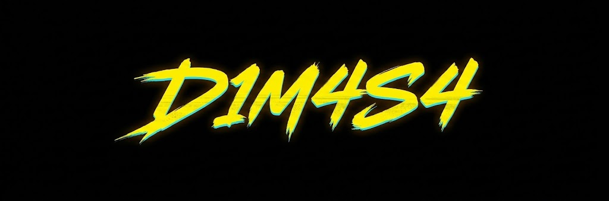

  <strong>Español</strong> | 
  <a href="./README-en.md">English</a> | 
  <a href="./README-ch.md">中文</a>

## Hola!!!, Yo soy Dimas Castañeda, aka D1M4S4 apasionado chamo de las Ciencias Computacionales, Ing. Aeroespacial y Electronica.

## BACKEND Developer: 

  

